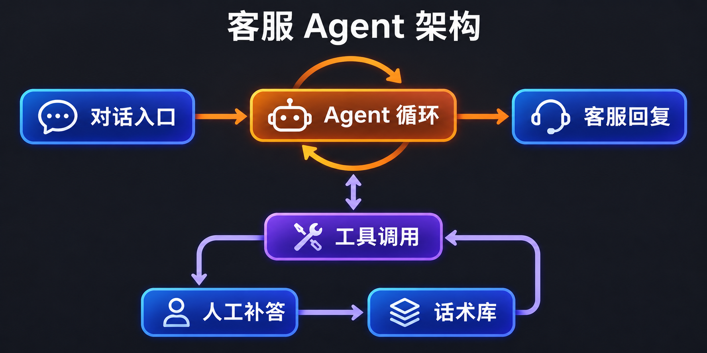

# AI 商品客服 Agent

**把一次客服回答拆成可追踪的工具调用，把答不上来的问题变成可复用的话术。**

客服遇到商品咨询、资料查询和需要人工判断的问题时，处理路径各不相同。这个项目把模型决策、业务工具和人工补答放在同一套服务里，界面可查看每轮执行轨迹。

## 架构怎么跑

| 层 | 实现 |
|---|---|
| 对话入口 | FastAPI 的 `/api/chat` 接收问题，对话服务组装上下文并选择模型提供方。 |
| Agent 循环 | 模型选择工具，运行时按调用 ID 写回工具结果，再让模型决定继续调用或直接回复。循环上限为 6 步。 |
| 工具层 | 把课程查询、话术检索和转人工做成独立能力，由工具注册与调度逻辑执行。 |
| 人工闭环 | 转人工生成工单。人工补答后形成话术样本，后续对话可通过检索取回同类答案。 |

**设计取舍**：限制循环步数，让一次对话的工具执行有明确上限。补答通过显式操作写入话术库，避免把模型的一次输出直接当成已确认知识。默认 Mock 模型便于复现工具分支，也可配置火山引擎 ARK。

## 一次客服请求如何完成

1. **接入对话**。浏览器把问题和会话标识交给 `/api/chat`。服务根据当前会话准备上下文，再选择 Mock 或 ARK 模型提供方。
2. **执行工具**。模型可以请求一个或多个工具。循环把工具名称、参数和调用 ID 放进消息，再把各工具的结果按对应 ID 回填，供下一轮决策使用。
3. **返回答案或转人工**。模型可直接结束回答，也可调用转人工工具生成工单。单次对话最多执行六步，前端可查看执行轨迹。
4. **补齐话术**。后台通过工单补答接口提交答案，服务把问答保存为话术样本。后续对话可用话术检索工具取回相似问题的答案。

## 可以在源码里核实什么

| 关注点 | 阅读入口 |
|---|---|
| 模型有哪些工具可以选，工具收发什么 | [工具注册及实现](app/agent/tools/) |
| 工具回包怎样进入下一轮，循环何时停止 | [循环实现](app/agent/loop.py) |
| 工单补答怎样变成可检索样本 | [补答服务](app/services/review_service.py)、[话术服务](app/services/playbook_service.py) |
| 业务端还能控制哪些内容 | [API 入口](app/main.py)包含话术管理、人工补答、指令配置和指标查询。 |

默认 Mock 模型适合检查分支和接口行为。配置 ARK 后才会发出真实模型请求。历史冒烟脚本引用了旧版审核接口，检查当前流程时以 `app/main.py` 为准。

## 源码入口

- [Agent 循环](app/agent/loop.py)
- [模型接口与提供方](app/llm/)
- [人工补答](app/services/review_service.py)和[话术管理](app/services/playbook_service.py)

## 本地启动

在根目录执行 `pip install -r requirements.txt` 和 `python run.py`，打开 `http://127.0.0.1:8000`。

项目基于课程示例代码。
